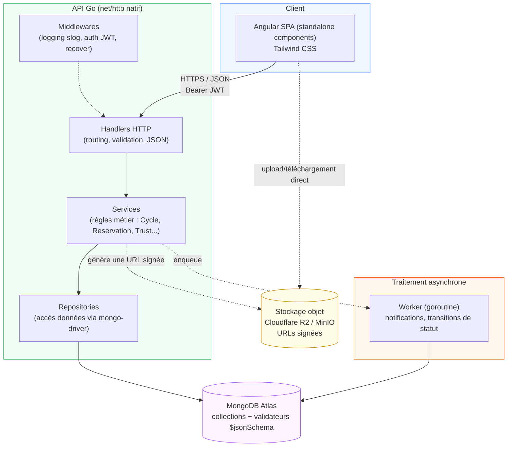
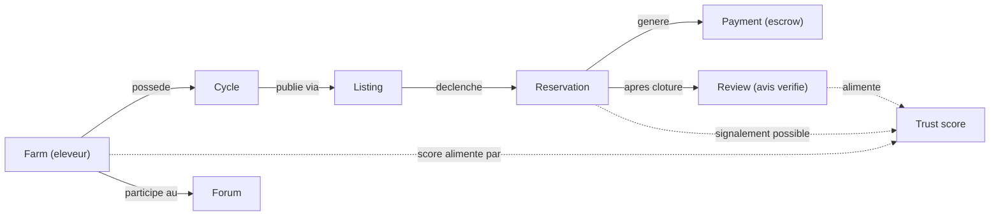
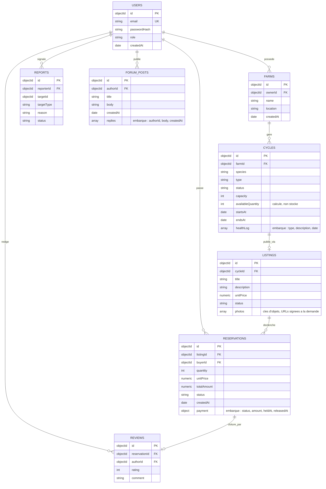
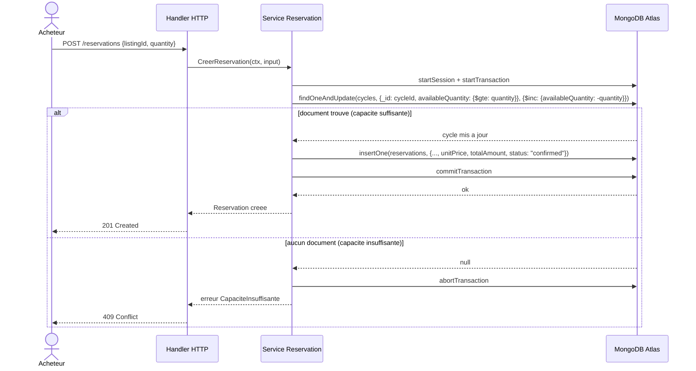
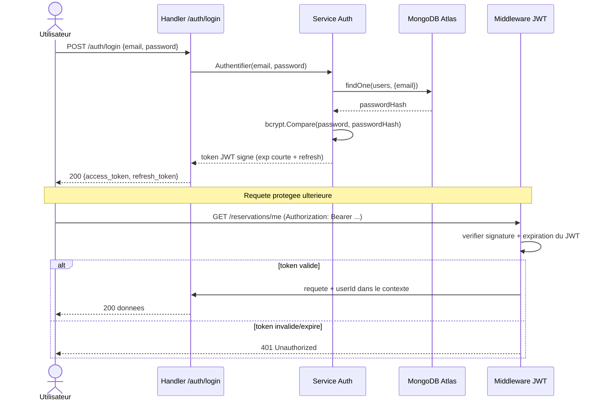
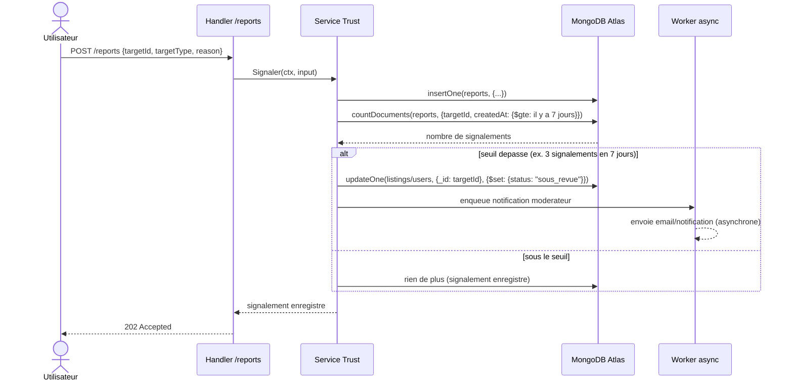
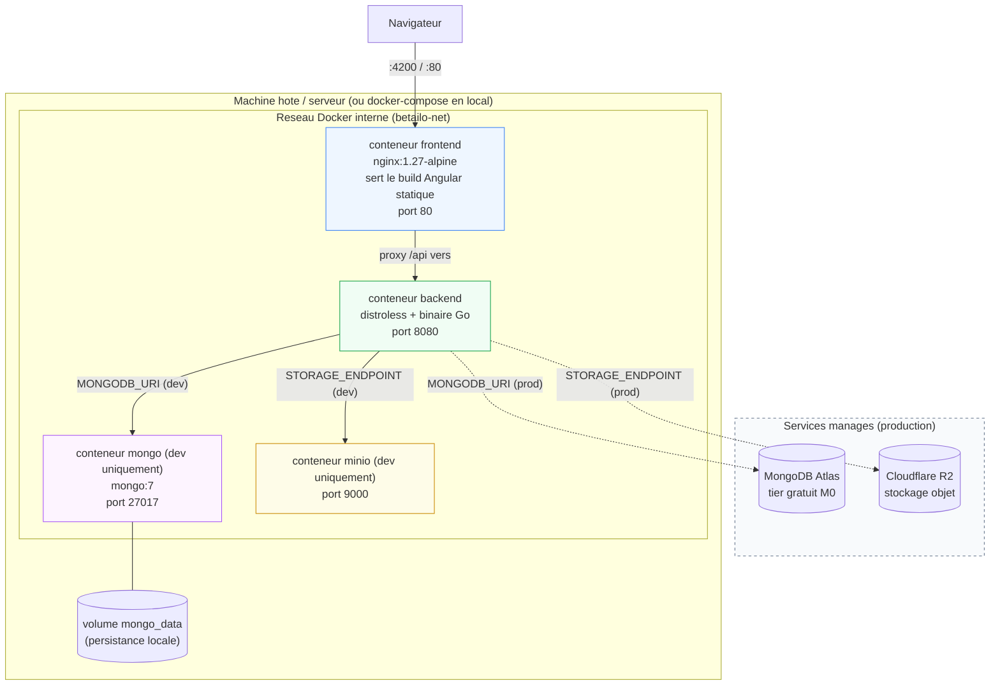
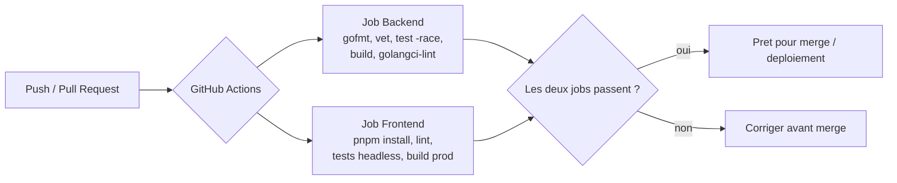

# Betailo — Concepts & Architecture

Sep 24, 2026 · @propose me a goland complete application to develop a an interme

## Pourquoi ce document

Le [document de proposition](https://claude.ai/artifact/1Rn28fFUoeUzRyWQT8zsin) decrit **quoi** construire et **pourquoi** (perimetre, fonctionnalites, stack, roadmap). Le [plan de developpement](https://claude.ai/artifact/F6hqrdgwqCHMHoVsNve5QF) decrit **quand** et **comment le demontrer** (phases, competences, tests, entretien).

Ce document repond a une troisieme question : **comment ca marche, concretement ?** Il explique les concepts du domaine (ce qu'est un "Cycle", pourquoi Betailo n'est pas un e-commerce classique) et montre, schemas a l'appui, comment les composants techniques s'articulent, des couches de l'API jusqu'aux conteneurs Docker. C'est le document a lire avant de plonger dans le code, ou a montrer en entretien pour expliquer une decision d'architecture en 30 secondes plutot qu'en 10 minutes.

## Vue d'ensemble de l'architecture

Betailo suit une architecture **monolithique modulaire** : un seul binaire Go, organise en couches et en modules metier, plutot qu'une multiplication de microservices que le perimetre ne justifie pas. C'est un choix assume et explique dans le document de proposition ; ce schema montre comment les blocs s'assemblent concretement.

Ce qu'il faut retenir de ce schema :

- **Le sens des dependances est a sens unique** : handler depend de service, service depend de repository — jamais l'inverse. Un repository ne connait rien du HTTP ; un handler ne touche jamais SQL directement. C'est ce qui rend chaque couche testable isolement (voir le plan de tests dans le document "Plan de developpement").
- **Les services ne se parlent pas directement entre modules.** Par exemple, le service Reservation ne modifie pas l'etat d'un Cycle en appelant le code du module Cycle : il passe par l'interface publique de ce module. Ca garde chaque module remplacable et compris independamment — utile en entretien pour expliquer une architecture "modulith".
- **Le worker asynchrone tourne dans le meme processus** (une ou plusieurs goroutines qui consomment une file en memoire ou une table "outbox" en base), pas dans un service separe : simple a deployer, tout en demontrant qu'on sait separer le travail synchrone (repondre vite a l'utilisateur) de l'asynchrone. Il a deux responsabilites concretes : envoyer les notifications (email, alerte) et faire progresser automatiquement le statut d'un Cycle dans sa machine a etats (`planifie -> actif -> termine`, ou `annule`), par exemple demarrer un cycle a sa date de debut ou expirer une reservation non payee apres un delai. C'est un exemple d'asynchrone bien plus parlant qu'un simple envoi d'email : il touche directement a la coherence des donnees metier.
- **Aucun ODM.** Le driver officiel `mongo-driver` et des requêtes explicites (`Find`, `UpdateOne`, `Aggregate`) dans les repositories, sans couche d'abstraction supplémentaire type `mgm` : la même philosophie que pour du SQL explicite, transposée au document — la requête reste lisible et son coût visible.
- **Le stockage de fichiers est isolé derrière une interface** (`storage.Provider`, deux méthodes : `PresignUpload` / `PresignDownload`). Le fournisseur concret (Cloudflare R2 en production, MinIO en local) est un détail d'implémentation injecté au démarrage — un exemple concret d'inversion de dépendance plutôt qu'un principe abstrait.

Correspondance avec le code : `cmd/api` (point d'entrée) -> `internal/platform/httpserver` (handlers + middlewares) -> `internal/<module>` (services + logique métier) -> `internal/platform/db` (connexion MongoDB, bootstrap des collections) et `internal/platform/storage` (URLs signées pour les fichiers).

## Les concepts du domaine, expliques simplement

Un e-commerce classique vend des **produits** : un stock fixe, un prix, on achete, le stock diminue. Betailo ne vend pas des produits, il donne acces a des **cycles d'elevage** : un evenement qui a un debut, une duree, une fin, et qui peut echouer ou reussir en cours de route. Comprendre cette difference explique presque toutes les decisions de modelisation ci-dessous.

### Cycle — le concept pivot

Un **Cycle** represente une periode d'elevage precise : une couvee de poussins, un lot de porcelets en engraissement, une periode de ponte, une gestation. Il a un statut qui evolue dans le temps (`planifie -> en cours -> termine` ou `annule`), une capacite (nombre de places / d'unites disponibles) et des dates cles. C'est l'entite **pivot** : tout le reste s'accroche a un Cycle plutot qu'a un "produit" statique.

Pourquoi ce choix plutot qu'un modele e-commerce standard : un acheteur qui reserve un cycle de couvee reserve en realite un **engagement futur et incertain** (le taux d'eclosion n'est jamais garanti a 100%), pas un objet deja en stock. Modeliser ça comme un "produit" cacherait cette incertitude et empecherait de representer proprement des notions comme la survente (voir plus bas) ou le suivi sanitaire en cours de cycle.

### Listing — l'offre visible

Un **Listing** est la fiche publique qu'un eleveur publie pour un Cycle : titre, description, race/espece, prix, photos. Un Cycle peut avoir un Listing (ce que les acheteurs voient) ; separer les deux permet par exemple de preparer un Cycle avant de le publier, ou de changer la presentation sans toucher aux donnees zootechniques.

### Reservation — la reponse a la rareté

Une **Reservation** engage une place ou une quantite sur un Cycle donne, avant que le cycle ne se termine. Le point delicat, et une des demonstrations techniques les plus interessantes du projet : eviter la **survente** (deux acheteurs qui reservent la derniere place en meme temps). C'est traite au niveau base de donnees (transaction + verrou ou contrainte, detaille dans le diagramme de sequence plus bas), pas seulement dans le code Go — la robustesse doit survivre a une charge concurrente.

### Trust & anti-scam — la confiance comme fonctionnalite de premier ordre

Dans un marche agricole informel, l'arnaque ("brouteur") est un risque concret et cite par les utilisateurs eux-memes. Le module **Trust** n'est pas une case a cocher secondaire : c'est un ensemble de signaux combines — verification de profil, historique de transactions reussies, avis verifies (uniquement apres une reservation reelle, jamais librement postes), signalement communautaire, et regles simples de detection (compte tres recent + prix anormalement bas + demande de paiement hors plateforme = signal fort). Le principe general : rendre visible ce qui rassure (badges, anciennete, avis verifies) et rendre couteux ce qui arnaque (delai avant premier retrait, revue manuelle des signalements repetes).

### Payment / Escrow — proteger les deux parties

Le paiement passe par une logique de type **sequestre (escrow)** simplifiee : l'argent de l'acheteur est marque "retenu" des la reservation, puis libere a l'eleveur seulement apres confirmation (livraison ou fin de cycle sans litige). Cote portfolio, c'est l'occasion de montrer une machine a etats explicite plutot qu'un simple champ booleen "paye" : `en_attente -> retenu -> libere`, avec deux issues alternatives possibles a tout moment avant liberation, `echoue` (le paiement lui-meme n'aboutit pas) et `rembourse` (litige ou annulation apres retenue).

### Forum — la couche communautaire

Le forum (posts + reponses) est volontairement simple dans le MVP : il sert a batir de la confiance et du contenu (questions d'elevage, retours d'experience) autour de la marketplace, pas a etre un forum generaliste. Il partage le meme systeme de signalement que le module Trust plutot que d'avoir sa propre moderation isolee.

### Comment ces concepts s'articulent

La lecture a retenir : **Cycle est au centre**, tout le reste (Listing, Reservation, Payment, Review) en decoule ou y fait reference ; Trust est transversal, alimente par plusieurs sources plutot que par un seul module.

## Modele de donnees

Structure des collections MongoDB, avec les relations par référence (`ObjectId`) et les sous-documents embarqués :

Quatre choix de modélisation spécifiques au document à remarquer :

- **`LISTINGS.cycleId` est une référence optionnelle** vers `CYCLES` : un Cycle peut exister avant d'être publié (pas encore de Listing). Contrairement à une base relationnelle, rien n'empêche techniquement de créer un Listing orphelin — cette cohérence-là est garantie par le service applicatif, pas par le schéma.
- **Trois relations bornées sont embarquées plutôt que référencées** : `healthLog` dans `CYCLES`, `payment` dans `RESERVATIONS`, `replies` dans `FORUM_POSTS`. Dans les trois cas, le sous-document est toujours lu et écrit avec son parent, et sa taille reste bornée (pas de carnet sanitaire ou de fil de discussion illimité) — exactement le cas d'usage que l'embarquement MongoDB cible. À l'inverse, `RESERVATIONS` reste une collection séparée de `LISTINGS` : c'est l'entité à plus fort volume d'écriture, et celle qui a besoin d'une mise à jour atomique indépendante (voir le diagramme de séquence anti-survente ci-dessous).
- **`RESERVATIONS.unitPrice` et `totalAmount` figent le prix au moment de la réservation**, comme une ligne de facture : si l'éleveur modifie le prix de son Listing ensuite, l'historique ne se recalcule pas rétroactivement. À l'inverse, `CYCLES.availableQuantity` n'est jamais recalculé à la volée côté application : c'est un compteur maintenu par décrémentation atomique (`findOneAndUpdate` avec `$inc`), la seule façon d'éviter la survente sans verrou explicite.
- **`REPORTS` utilise `targetId` / `targetType`** pour signaler indifféremment une annonce, un profil ou un message. En relationnel, ce choix coûtait une contrainte d'intégrité référentielle gérée côté application plutôt que par la base ; en MongoDB la question ne se pose même plus, puisqu'aucune collection n'impose de clé étrangère — un des rares cas où changer de base de données rend un compromis existant caduc plutôt que d'en créer un nouveau.

## Diagrammes de sequence des flux critiques

### 1. Reservation d'un cycle, sans survente

Le flux le plus sensible du MVP : deux acheteurs peuvent cliquer "reserver" au meme instant sur les dernieres places disponibles. La protection se joue en base de donnees, dans une transaction, pas seulement dans le code Go.

Le `findOneAndUpdate` avec la condition `availableQuantity: {$gte: quantity}` est atomique au niveau du document : si deux acheteurs réservent en même temps les dernières places, MongoDB garantit qu'une seule des deux opérations verra la condition satisfaite — pas besoin de verrou explicite comme en SQL. La transaction multi-documents (`startSession`/`commitTransaction`, supportée sur le tier gratuit Atlas car toujours un replica set) garantit que la décrémentation de capacité et la création de la réservation réussissent ou échouent ensemble.

### 2. Authentification (login + requete protegee)

### 3. Signalement anti-scam et reaction automatique

Le choix de traiter la notification au moderateur **de facon asynchrone** (via le worker) plutot que dans la requete HTTP evite de ralentir la reponse a l'utilisateur qui signale, et illustre concretement la separation synchrone/asynchrone deja mentionnee dans la vue d'ensemble.

## Architecture de deploiement

Correspond directement au `docker-compose.yml` du depot : trois conteneurs, un reseau interne, un volume persistant pour les donnees.

Points d'implementation a noter :

- **Build multi-stage** pour les deux images applicatives : le backend compile avec l'image `golang` complete puis copie uniquement le binaire dans une image `distroless` finale (surface d'attaque minimale, image legere) ; le frontend compile avec `node:22-alpine` + pnpm puis copie seulement `dist/frontend/browser` dans une image `nginx:1.27-alpine`. Aucune des deux images finales ne contient de toolchain de build.
- **Le seul état qui a besoin d'un volume local est celui du conteneur `mongo` de développement.** En production, MongoDB Atlas et Cloudflare R2 sont des services managés : aucun volume à gérer, aucune sauvegarde à scripter soi-même. Les conteneurs backend et frontend restent stateless et peuvent être recréés/redéployés sans perte de données.
- **La CI (`.github/workflows/ci.yml`) est separee du deploiement** : deux jobs independants (Go / Angular) valident chaque push, mais aucun n'implique encore de build/push d'image Docker automatise — c'est identifie comme une extension naturelle post-MVP (image registry + job de deploiement), deja notee dans la feuille de route post-MVP du document "Plan de developpement".
- **Le même code pointe vers des services différents selon l'environnement**, uniquement via les variables `MONGODB_URI` et `STORAGE_ENDPOINT` : MinIO et un Mongo local en développement, Atlas et R2 en production. Aucune branche `if environment == "prod"` dans le code applicatif — c'est la configuration qui change, pas la logique.

Les deux jobs sont independants (`working-directory` distinct, pas d'etape partagee) : une regression frontend ne bloque pas la validation d'une pull request purement backend, et inversement — un choix deliberement documente dans le README du depot.
