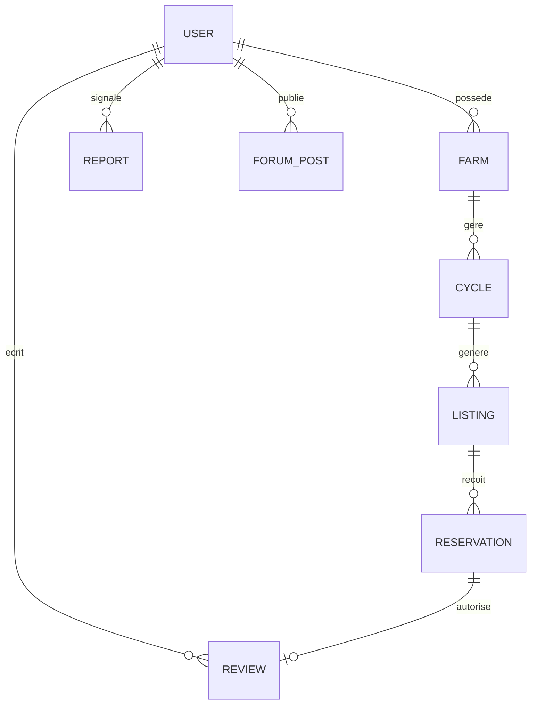

# Plateforme Éleveurs — Proposition d'application Go (MVP Portfolio)

Sep 23, 2026 · @propose me a goland complete application to develop a an interme

## Contexte et objectifs

L'idée : une plateforme de mise en relation pour éleveurs (volailles, petits ruminants, porcins, etc.), où l'activité tourne autour de **cycles** — un cycle de reproduction, de croissance ou d'engraissement qui a un début, une durée et une fin. Un acheteur ne réserve pas juste "un produit", il réserve une place dans un cycle en cours ou à venir (ex. : réserver 10 poussins du prochain lot, ou un lot de porcs arrivant à maturité dans 6 semaines).

Ce choix de périmètre (MVP) sert un objectif précis : produire, en Go, un projet de portfolio **fini et cohérent** plutôt qu'une liste de fonctionnalités à moitié construites. Il est calibré pour un niveau intermédiaire : assez riche pour montrer une vraie architecture (API REST, base de données relationnelle, authentification, tâches asynchrones, tests), mais assez borné pour être livrable seul.

Ce que le MVP prouve à un recruteur ou un client :

- Capacité à modéliser un domaine métier non trivial (le "cycle" n'est pas un simple produit e-commerce).
- Maîtrise des briques standard d'un backend Go en production (routing, middleware, validation, persistance, sécurité).
- Sens du produit : savoir couper un cahier des charges ambitieux en un MVP livrable et démontrable.

Les sections suivantes détaillent le périmètre fonctionnel, l'architecture technique, le modèle de données, la structure du code et une roadmap de développement en phases.

## Périmètre MVP — fonctionnalités e-commerce & réservations

Ce socle reprend les briques classiques d'un site marchand, adaptées à la logique "par cycle".

| Bloc                  | Fonctionnalités                                                                                                                                                                 | Note                                                                          |
| --------------------- | ------------------------------------------------------------------------------------------------------------------------------------------------------------------------------- | ----------------------------------------------------------------------------- |
| Comptes               | Inscription/connexion, rôles (éleveur, acheteur, admin), profil éleveur avec exploitation (localisation, espèces élevées)                                                       | JWT + refresh token                                                           |
| Catalogue             | Annonces liées à un cycle (espèce, race, quantité disponible, prix, date de disponibilité estimée), recherche/filtres (espèce, région, prix, date)                              | Un cycle peut avoir plusieurs annonces (ex. : lot vendu en plusieurs tailles) |
| Réservation par cycle | Réserver une quantité dans un cycle en cours, acompte optionnel, statut (en attente, confirmée, livrée, annulée), gestion du stock restant du cycle en temps réel               | Point le plus "métier" du projet : évite la survente sur un cycle             |
| Panier & paiement     | Panier multi-annonces, intégration paiement (Stripe en sandbox, ou Mobile Money via une interface abstraite étant donné le contexte Cameroun/Afrique), historique des commandes | Le paiement peut rester simulé/sandbox pour un portfolio                      |
| Avis & commentaires   | Notation (1-5) et commentaire sur un éleveur ou une transaction, uniquement après réservation confirmée                                                                         | Évite les faux avis, alimente le score de confiance (section anti-scam)       |
| Notifications         | Email ou notification interne : confirmation de réservation, cycle bientôt terminé, nouvel avis                                                                                 | File d'attente asynchrone (voir architecture)                                 |

Ce tableau constitue le périmètre "obligatoire" du MVP ; tout le reste (zootechnie avancée, forum riche, anti-scam poussé) vient s'y greffer sans le remettre en cause.

## Fonctionnalités spécifiques au domaine zootechnique

C'est ce qui distingue le projet d'un e-commerce générique et justifie le mot "cycle" :

1. **Gestion des cycles d'élevage**
   - Un cycle a un type (reproduction, engraissement, ponte...), une espèce/race, une date de début, une durée attendue et un statut (planifié, en cours, terminé).
   - Les annonces et réservations sont toujours rattachées à un cycle, jamais à un "produit" statique.
2. **Fiche technique par espèce/race**
   - Données de référence (durée de cycle typique, poids/âge cible, besoins d'élevage) affichées sur chaque annonce pour informer l'acheteur.
3. **Carnet sanitaire simplifié**
   - Journal par cycle : vaccinations, traitements, incidents sanitaires. Champ optionnel mais consultable par l'acheteur avant réservation — un argument de confiance fort dans ce secteur.
4. **Traçabilité**
   - Chaque animal/lot vendu garde une référence vers son cycle d'origine et l'exploitation, consultable après achat (utile en cas de litige ou de rappel sanitaire).
5. **Alertes de cycle**
   - Rappel automatique à l'éleveur quand un cycle approche de sa fin (à mettre en vente) ou à l'acheteur quand sa réservation approche de la livraison.

Ces points restent volontairement simples dans le MVP (quelques champs structurés, pas de modèle agronomique complexe), mais ils donnent au projet une identité métier claire plutôt qu'un clone genérique de boutique en ligne.

## Forum communautaire

Un forum simple, rattaché au même système de comptes que la marketplace :

- **Catégories** fixes au départ : par espèce (volaille, porcins, ruminants...), "Bonnes pratiques", "Marché & prix", "Questions sanitaires".
- **Fils de discussion** : titre, corps, réponses imbriquées sur un seul niveau (pas de threads infinis à gérer côté MVP), vote simple (utile/pas utile).
- **Lien avec la marketplace** : un fil peut référencer une annonce ou un cycle (ex. : "Quelqu'un a déjà acheté chez cet éleveur ?"), ce qui alimente aussi la confiance.
- **Modération de base** : signalement d'un message, statut masqué/visible, rôle modérateur (peut être le même que l'admin en MVP).

Ce module est volontairement léger : il sert surtout à montrer une gestion de contenu généré par les utilisateurs (relations parent/enfant, pagination, modération) sans complexifier le cœur transactionnel du projet.

## Sécurité et système anti-scam

Sujet sensible dans ce type de marché (annonces d'animaux, paiements d'acompte à distance). Le MVP couvre les mécanismes qui rapportent le plus de confiance pour le moins de complexité :

1. **Vérification d'identité de l'éleveur** : upload d'une pièce d'identité ou d'un justificatif d'exploitation, badge "Profil vérifié" après validation manuelle par un admin (pas besoin d'un KYC automatisé pour un MVP).
2. **Score de confiance** : calculé à partir de — note moyenne des avis, nombre de cycles menés à terme, ancienneté du compte, statut vérifié. Affiché sur chaque annonce.
3. **Signalement** : bouton "signaler" sur une annonce, un profil ou un message de forum, avec motif (arnaque suspectée, contenu abusif, annonce fictive...) ; file de modération côté admin.
4. **Paiement séquestre (escrow) simplifié** : l'acompte est marqué "retenu" jusqu'à confirmation de livraison par l'acheteur (ou délai automatique), au lieu d'un virement direct à l'éleveur — réduit le risque de paiement sans livraison.
5. **Détection de comportements suspects (règles simples, pas de ML)** : alertes automatiques sur des motifs comme plusieurs comptes créés depuis la même IP en peu de temps, annonces à prix anormalement bas pour l'espèce/quantité, taux de réservations annulées anormalement élevé pour un éleveur.
6. **Rate limiting & anti-bot** sur inscription, connexion et création d'annonces (protection basique contre le spam / les faux comptes, souvent lié aux "brouteurs").

Ces mécanismes sont précisément ce qui permet de parler, en entretien, de décisions de sécurité concrètes plutôt que d'une authentification générique.

## Architecture technique et stack Go

| Couche                   | Choix proposé                                                                                                                                                                                             | Pourquoi                                                                                                                                                                                                                                          |
| ------------------------ | --------------------------------------------------------------------------------------------------------------------------------------------------------------------------------------------------------- | ------------------------------------------------------------------------------------------------------------------------------------------------------------------------------------------------------------------------------------------------- |
| Framework HTTP           | `net/http` (Go 1.22+) avec son routeur natif amélioré, ou `chi` si un routeur plus riche est souhaité                                                                                                     | Montre une bonne compréhension du standard library avant de s'appuyer sur un framework "tout-en-un" comme Gin                                                                                                                                     |
| Architecture applicative | Architecture en couches : `handler` (HTTP) → `service` (logique métier) → `repository` (accès données), avec interfaces entre chaque couche                                                               | Facilite les tests unitaires (mocks sur les interfaces) et montre une séparation des responsabilités                                                                                                                                              |
| Base de données          | MongoDB Atlas (tier gratuit M0), accès via le driver officiel `mongo-driver` (pas d'ODM, requêtes explicites comme pour le SQL)                                                                           | Modèle document adapté aux sous-documents naturels du domaine (carnet sanitaire, paiement, réponses de forum) ; démontre un second paradigme de base de données à côté du relationnel, plus les transactions multi-documents pour l'anti-survente |
| Schéma & index           | Aucune migration SQL : validateurs `$jsonSchema` par collection + un bootstrap Go idempotent qui crée les collections et index au démarrage                                                               | Le schéma reste explicite et versionné dans le code, sans dépendre d'un outil de migration séparé                                                                                                                                                 |
| Authentification         | JWT (access + refresh token), middleware de rôles (éleveur / acheteur / admin)                                                                                                                            | Sujet systématiquement testé en entretien backend                                                                                                                                                                                                 |
| Tâches asynchrones       | Worker en goroutines + une file simple (collection `jobs` en MongoDB, ou Redis + `asynq` si vous voulez montrer Redis) pour : notifications, transitions de statut de cycle, calcul du score de confiance | Démontre la gestion de la concurrence, point fort attendu en Go                                                                                                                                                                                   |
| Validation               | `go-playground/validator` sur les DTOs d'entrée                                                                                                                                                           | Évite de la logique de validation éparpillée                                                                                                                                                                                                      |
| Documentation API        | OpenAPI/Swagger généré (`swaggo`)                                                                                                                                                                         | Un portfolio avec une API documentée se démontre beaucoup mieux                                                                                                                                                                                   |
| Tests                    | `testing` standard + `testify` pour les assertions, tests d'integration sur une instance MongoDB de test (via `testcontainers-go`, image `mongo`)                                                         | Niveau intermédiaire attendu : tests unitaires ET tests d'intégration                                                                                                                                                                             |
| Conteneurisation         | `Dockerfile` multi-stage + `docker-compose` (app + MongoDB local pour le dev + MinIO pour le stockage objet en dev ; MongoDB Atlas et Cloudflare R2 en production, mêmes interfaces)                      | Déploiement reproductible, facile à faire tourner pour un recruteur                                                                                                                                                                               |
| Observabilité            | Logs structurés (`slog`, natif depuis Go 1.21), middleware de logging des requêtes                                                                                                                        | Petit détail qui montre une hygiène "production-ready"                                                                                                                                                                                            |
| Stockage de fichiers     | Interface storage.Provider (URLs signées, PUT/GET) ; implémentation Cloudflare R2 (compatible S3) en production, MinIO en local                                                                           | Upload direct navigateur vers le bucket (le fichier ne transite jamais par l'API) ; le provider concret est interchangeable sans toucher au code métier                                                                                           |

Ce choix évite volontairement un framework lourd type microservices/Kubernetes : pour un portfolio intermédiaire, un monolithe bien structuré et testé est plus convaincant qu'une architecture distribuée mal terminée.

## Frontend : Angular + Tailwind

| Aspect        | Choix                                                                                                                                                                                                                    | Pourquoi                                                                                                           |
| ------------- | ------------------------------------------------------------------------------------------------------------------------------------------------------------------------------------------------------------------------ | ------------------------------------------------------------------------------------------------------------------ |
| Framework     | Angular (dernière version stable), standalone components, signals pour l'état local                                                                                                                                      | Cohérent avec un profil fullstack orienté entreprise ; les signals simplifient la réactivité sans NgRx pour un MVP |
| Style         | Tailwind CSS, avec un fichier `tailwind.config` qui porte la palette et les tokens définis dans la direction artistique (section suivante)                                                                               | Évite le CSS éparpillé ; les tokens de couleur/espacement sont centralisés                                         |
| État global   | Angular signals + un petit store maison (pas de NgRx pour un MVP) : session utilisateur, panier, notifications                                                                                                           | Suffisant à cette échelle, plus simple à expliquer en entretien                                                    |
| Client API    | Service Angular par domaine (`CycleService`, `ReservationService`...) au-dessus de `HttpClient`, types générés ou recopiés depuis le schéma OpenAPI du backend                                                           | Garde le typage cohérent entre Go et Angular                                                                       |
| Icones        | Bibliothèque d'icônes simples et "parlantes" (ex. Heroicons ou Lucide) plutôt que des pictogrammes abstraits                                                                                                             | Essentiel pour un public peu digitalisé : l'icône doit être reconnaissable sans lecture                            |
| Structure     | `src/app/features/<domaine>` (cycle, reservation, forum, trust...) + `src/app/shared` (composants UI réutilisables : bouton, carte, badge de confiance, champ de formulaire) + `src/app/core` (auth, intercepteurs HTTP) | Miroir de la structure du backend, lisible pour un recruteur qui parcourt le repo                                  |
| Accessibilité | Contrastes AA minimum, tailles de police et zones cliquables généreuses (min. 44px), labels toujours visibles à côté des icônes, pas de jargon technique dans l'UI                                                       | Public cible décrit comme peu à l'aise avec le numérique : la simplicité prime sur la densité d'information        |

Principe directeur pour toute l'UI : **une action visible = un verbe clair + une icône + un mot**, jamais une icône seule ni un jargon ("Réserver", pas "Booker" ; "Mon cheptel", pas "Dashboard"). Les flows longs (créer une annonce, réserver) sont découpés en étapes courtes avec une barre de progression, plutôt qu'un formulaire unique et dense.

## Modèle de données (entités principales)



Entités clés et champs essentiels :

- **User** : id, email, mot de passe (hashé), rôle (eleveur/acheteur/admin), statut vérifié, score de confiance, date de création.
- **Farm** (exploitation) : id, ownerId (référence User), nom, localisation, espèces élevées.
- **Cycle** : id, farmId (référence Farm), espèce/race, type (reproduction/engraissement...), date de début, durée estimée, statut (planifié/actif/terminé/annulé), healthLog (tableau embarqué d'événements sanitaires : type, description, date).
- **Listing** (annonce) : id, cycleId (référence Cycle), titre, description, quantité disponible, prix unitaire, date de disponibilité, photos (clés d'objets accessibles via URLs signées).
- **Reservation** : id, listingId (référence Listing), buyerId, quantité, statut, prix unitaire figé au moment de la réservation, montant total, date, payment (sous-document embarqué : statut retenu/libéré/échoué/remboursé, montant, dates).
- **Review** : id, reservationId (référence Reservation), note, commentaire, date.
- **Report** (signalement) : id, reporterId, cible (annonce/profil/message), motif, statut.
- **ForumPost** : id, authorId, catégorie, titre/contenu, listingId optionnel (référence croisée), replies (tableau embarqué de réponses : authorId, contenu, date).

Le point structurant : **Cycle** est le pivot du modèle — tout (annonce, carnet sanitaire, alertes) en dépend, alors qu'un e-commerce classique partirait d'un simple "Produit".

## Structure du projet et organisation du code

```text
eleveurs-platform/
├── cmd/
│   └── api/                 # point d'entree (main.go), cablage des dependances
├── internal/
│   ├── auth/                # JWT, hachage mot de passe, middleware de roles
│   ├── user/                # handler + service + repository
│   ├── farm/
│   ├── cycle/               # coeur metier zootechnique (inclut le carnet sanitaire embarque)
│   ├── listing/
│   ├── reservation/         # logique anti-survente (findOneAndUpdate atomique + transaction), statuts
│   ├── payment/             # sous-document embarque dans reservation, abstraction sandbox
│   ├── review/
│   ├── forum/
│   ├── trust/               # score de confiance, signalements, regles anti-scam
│   ├── notification/        # worker asynchrone
│   └── platform/
│       ├── db/              # connexion MongoDB, bootstrap des collections/index/validateurs
│       ├── storage/         # interface Provider (URLs signees) + adaptateurs R2 / MinIO
│       └── httpserver/      # routeur, middlewares transverses
├── schemas/                 # validateurs $jsonSchema par collection (JSON)
├── pkg/                     # code reutilisable hors du module (rare en MVP)
├── docs/                    # openapi.yaml genere
├── docker-compose.yml
├── Dockerfile
└── go.mod
```

Conventions clés :

- Chaque module métier (`cycle`, `reservation`, `trust`...) expose une interface de `service` ; le `handler` HTTP ne dépend que de cette interface — ce qui rend les handlers testables sans base de données.
- `internal/` empêche toute réutilisation accidentelle du code en dehors du module, conforme aux conventions Go.
- Un test unitaire par service (mock du repository), un test d'integration par module critique (`reservation`, `payment`, `trust`) contre une vraie instance MongoDB de test.
- Un seul binaire (`cmd/api`) pour tout le MVP ; le worker de notifications tourne comme une goroutine lancée au démarrage du même binaire, pas un microservice séparé — plus simple à faire tourner et à présenter.

## Direction artistique (à fournir telle quelle à l'outil de conception d'interfaces)

Ce brief est écrit pour être copié-collé tel quel comme instruction de départ. Principe directeur : **simple et rassurant avant d'être "moderne"** — le public cible (éleveurs, souvent peu à l'aise avec le numérique) doit comprendre chaque écran en un coup d'œil.

**Palette de couleurs**

| Rôle                     | Couleur                                            | Code            | Usage                                                                                                                    |
| ------------------------ | -------------------------------------------------- | --------------- | ------------------------------------------------------------------------------------------------------------------------ |
| Primaire                 | Vert émeraude terreux                              | `#2F6F4F`       | Actions principales, boutons, liens actifs — évoque la croissance et l'élevage sans être criard                          |
| Accent                   | Terracotta chaud                                   | `#E07A3E`       | Mise en avant (badges, alertes de cycle, call-to-action secondaires) — évoque la terre, chaleureux                       |
| Confiance                | Bleu ardoise                                       | `#3D6B8C`       | Badge "profil vérifié", score de confiance, liens informatifs                                                            |
| Fond                     | Blanc cassé chaud                                  | `#FAF7F2`       | Arrière-plan principal — plus doux qu'un blanc pur, moins "écran froid"                                                  |
| Texte                    | Brun très foncé                                    | `#2B2622`       | Texte principal — meilleur contraste et plus doux qu'un noir pur                                                         |
| Succès / Alerte / Erreur | Vert `#3C9A5F` / Ambre `#D99A2B` / Rouge `#C0453A` | états standards | À utiliser uniquement pour les statuts (réservation confirmée, cycle bientôt terminé, erreur), jamais pour la décoration |

Contraste minimum AA (4.5:1) sur tout texte fonctionnel.

**Typographie**

- Une seule famille pour tout le produit, humaniste et très lisible : **Inter** (ou **Work Sans** en alternative) pour les textes ET les titres — éviter de mélanger deux polices, source de confusion pour un public peu habitué aux interfaces.
- Taille de base 16px minimum sur mobile (jamais en dessous), titres en 20-28px, poids gras réservé aux titres et labels d'action.
- Phrases courtes, vocabulaire du quotidien ("Mon cheptel", "Mes réservations", "Vendre un lot"), aucun anglicisme ni jargon technique visible à l'écran.

**Iconographie**

- Icônes trait (line icons) aux angles arrondis, style Heroicons/Lucide, épaisseur de trait constante.
- Chaque icône est **toujours accompagnée d'un mot** — jamais d'icône seule pour une action importante.
- Icônes métier illustratives plutôt qu'abstraites : une silhouette de poule/chèvre pour "espèce", un cercle avec flèche pour "cycle en cours", un bouclier pour "profil vérifié".

**Principes UI/UX**

1. **Mobile-first strict** : barre de navigation basse avec 5 entrées maximum (Accueil, Annonces, Réservations, Forum, Profil), pas de menus imbriqués sur plus de 2 niveaux.
2. **Zones cliquables larges** (44px minimum), espacement généreux entre les éléments — mieux vaut faire défiler que tasser.
3. **Divulgation progressive** : les détails techniques (carnet sanitaire, fiche zootechnique complète) sont repliés sous un bouton "Voir plus de détails", jamais affichés d'emblée.
4. **Retour visuel systématique** : chaque action importante (réserver, publier une annonce, envoyer un message) confirme par un message clair ("Votre réservation est envoyée") plutôt qu'un simple changement discret d'écran.
5. **Cartes plutôt que tableaux** pour les annonces et cycles (photo, espèce, prix, statut, badge de confiance) — un tableau dense est intimidant pour ce public, une carte illustrée se scanne visuellement.
6. **Coins arrondis (8-12px)**, ombres douces et discrètes, look chaleureux et rural-moderne — à l'opposé d'une esthétique "startup tech froide".
7. **Ton éditorial** : bienveillant, direct, respectueux — on s'adresse à un professionnel de l'élevage, pas à un utilisateur "grand public" générique.

Ce brief couvre les écrans clés à concevoir en priorité : accueil/catalogue, fiche annonce + cycle, flow de réservation en étapes, profil éleveur avec score de confiance, forum, et l'écran de création d'annonce/cycle côté éleveur.

## Nom de la plateforme (3e proposition, après vérification)

"Agora Cheptel" n'est pas déjà pris, mais il sonne administratif plutôt que "sexy". Une recherche rapide montre aussi des acteurs déjà sur ce créneau en Afrique — à connaître pour se différencier, pas à copier : **FarmEase** (app de gestion pour éleveurs/agriculteurs camerounais), **Animarket** et **Gajo Livestock** (marketplaces bétail en Afrique), **Mlouma** (Sénégal, plateforme agriculteurs/acheteurs). Ces noms sont soit très descriptifs (Animarket, FarmEase), soit propres/inventés (Gajo, Mlouma) — la deuxième famille est plus "sexy" et plus facile à protéger comme marque.

**Betailo** (contraction inventée de _bétail_) — nouvelle recommandation principale.

- Nom court, inventé, prononcçable en français comme en anglais, dans le même esprit que les marques africaines modernes (Wave, Chipper...) : une racine claire ("bétail") + une terminaison qui sonne comme un produit, pas une administration.
- Aucune collision trouvée lors de la vérification (à confirmer par une recherche de marque/domaine avant usage réel).
- Se décline bien : `betailo.com` / `.cm`, "la communauté Betailo", "vendu sur Betailo".

Alternative dans le même esprit : **Troupo** (de _troupeau_) — encore plus court et jouable, évoque directement le groupe/la communauté (un troupeau, c'est aussi un collectif), sonne jeune et app-like ; aucune collision produit trouvée non plus (une seule occurrence : un nom de personne sur les réseaux sociaux).

"Agora Cheptel" reste en réserve si une sonorité plus institutionnelle/professionnelle est préférée (ex. pour un dossier ou un jury plus formel). Sauf préférence contraire, le reste de ce document part désormais sur **Betailo**.

⚠️ Ceci reste une vérification rapide par recherche web, pas un contrôle de marque/INPI/OAPI en bonne et due forme — à faire avant tout usage commercial réel, mais suffisant pour un projet portfolio.

## Prompt pour la génération IA du logo (version abstraite)

Direction retenue après revue des 9 propositions testées : **un symbole abstrait (boucle + feuille), sans animal représenté**. Raison : la plateforme couvre plusieurs espèces (volaille, chèvres, porcins...) ; un coq ou une poule en emblème signalerait "volaille uniquement" dès le premier regard, alors qu'une boucle fermée reste directement liée au concept central du produit (le cycle d'élevage) sans exclure aucune espèce. C'est aussi plus simple à lire en très petite taille (favicon, icône d'app) et plus intemporel.

Prêt à copier-coller dans un générateur d'images (Midjourney, DALL-E, etc.) :

```
A minimalist flat vector logo mark for an agritech platform for livestock
farmers, built around the idea of a breeding/production cycle.
Concept: an abstract closed loop (two arrow-like curves meeting to form a
circle, suggesting continuity and a repeating cycle) with a single small
leaf shape growing from inside the loop, symbolizing growth. No animal,
no text, no gradients, no realistic detail — deliberately species-neutral
so it represents poultry, goats, pigs and other livestock equally.
Style: clean geometric line + flat fill, rounded terminals, friendly and
trustworthy, modern rural-tech feel (not corporate-cold, not cartoonish).
Color palette: deep earthy emerald green (#2F6F4F) as the primary loop
shape, warm terracotta orange (#E07A3E) as a single accent on the leaf or
one arrow tip only, on a plain warm off-white background (#FAF7F2).
Composition: centered, single focal shape, balanced negative space, must
stay legible as a tiny app icon (readable at 32x32px) and in single-color
(all-green or all-dark) versions.
Format: square, vector-style, high contrast between shape and background.
```

Variantes à tester : un trait de boucle légèrement plus épais pour la lisibilité en favicon, et une variante avec un petit point/graine au centre de la boucle pour renforcer la lecture "croissance". Demander 3-4 propositions, puis les tester réellement à 32px avant de choisir.

**Retour sur la 1ère série de propositions générées** (boucle fermée + feuille, sans animal) : la variante avec une seule feuille orange dans la boucle est la plus propre et la plus lisible — c'est celle à garder comme logo principal. La variante à 100% verte (sans accent orange) fonctionne bien comme version monochrome/filigrane, ce qui confirme que le mark reste lisible en une seule couleur. La variante avec un point orange au-dessus de la feuille est à écarter : elle peut se lire comme une silhouette de personnage plutôt qu'une feuille, ce qui brouille le message. Le carré arrondi vert avec le mark en blanc, en bas des propositions, est le bon format pour l'icône d'application.

**Prochaine étape suggérée** : une fois cette direction (logo + nom **Betailo**, voir ci-dessus) validée, faire vectoriser proprement la variante retenue (feuille orange seule dans la boucle), puis transmettre logo + direction artistique + nom à l'outil de conception d'interfaces pour produire les premières maquettes (accueil, fiche annonce, flow de réservation).
